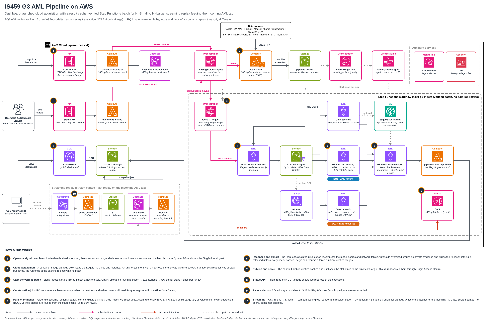

<div align="center">

# IS459 Group 3 · AML Pipeline on AWS

**Anti-money-laundering analytics for 180 million synthetic bank transfers,
from raw Kaggle files to a live dashboard, fully serverless on AWS.**

[](https://d1n61tlw9pcrog.cloudfront.net/)
[](planning/aws-deployment-status.md)
[](infra/README.md)
[](pyproject.toml)

[**Open the dashboard**](https://d1n61tlw9pcrog.cloudfront.net/) ·
[Architecture](#architecture) ·
[Quick start](#quick-start) ·
[Documentation](planning/README.md) ·
[Deployment status](planning/aws-deployment-status.md)

</div>

---

## Two business questions

<table>
<tr>
<td width="50%" valign="top">

### BQ1 · Which payments should investigators review first?

A frozen **XGBoost** model (`hist-depth5-delta1`) scores **every** transaction from
0 to 1 and turns the scores into a ranked review queue, with the reasons behind each
score and a simple rule baseline to compare against.

*For compliance and fraud-operations teams.*

</td>
<td width="50%" valign="top">

### BQ2 · Which accounts act like a mule network?

A Spark graph job finds **hubs** (money in from many, out to many),
**three-account loops**, **back-and-forth pairs** and the **rings** that join them,
so related alerts become one case.

*For mule-account and network investigation teams.*

</td>
</tr>
</table>

Data: the [IBM Transactions for Anti-Money Laundering](https://www.kaggle.com/datasets/ealtman2019/ibm-transactions-for-anti-money-laundering-aml)
dataset (synthetic), enriched with historical FX rates so every amount is compared in USD.

## At a glance

| | |
|---|---|
| **Largest run** | HI-Large: **179,702,229** transactions scored, 1.93M accounts mapped, 9,732 rings found |
| **Datasets run on AWS** | HI-Small (5.1M rows) · HI-Medium (31.9M) · HI-Large (179.7M) |
| **Orchestration** | AWS Step Functions; every paid step runs once and is never auto-retried |
| **Reuse** | An identical request returns its published result instantly; verified stages are reused up to 50M rows |
| **Recovery** | A failed run can resume from its verified stages instead of starting over |
| **Checks** | Every score and network table is recomputed independently before anything is published |
| **Streaming** | Kinesis → Lambda scoring with exact batch parity, shown on the **Incoming AML** tab (stream parked to save cost) |
| **Cost visibility** | The Ingestion tab shows real AWS spend from Cost Explorer |

## The dashboard

[d1n61tlw9pcrog.cloudfront.net](https://d1n61tlw9pcrog.cloudfront.net/) has four tabs:

- **BQ1 review queue:** ranked transactions, explanations and accuracy by period.
- **BQ2 mule networks:** ring explorer, hubs, loops and pairs.
- **Incoming AML:** transactions scored one at a time by the streaming replay.
- **Ingestion:** live pipeline status, operator run controls and the AWS cost panel.

The public view is read-only. Starting a run needs operator sign-in with the Group 3
AWS identity; see the [control stack](infra/dashboard-control/README.md).

## Architecture

<p align="center">
  <a href="docs/is459-g3-aml-pipeline-aws.drawio">
    
  </a>
</p>

1. **Launch.** An operator starts a run from the Ingestion tab, or an opt-in S3 upload
   trigger starts it through EventBridge.
2. **Acquire.** `is459-g3-cloud-ingest` runs a container Lambda that downloads the
   Kaggle files and historical FX into S3. If the same request was already published,
   the run stops here and returns that release.
3. **Curate.** Glue converts amounts to USD and builds earlier-event-only behaviour
   features, written as date-partitioned Parquet in the Glue Data Catalog.
4. **Analyse in parallel.** Glue runs the rule baseline (with optional SageMaker
   candidate training), BQ1 frozen scoring and BQ2 network detection at the same time.
5. **Verify and export.** A checkpointed Glue export recomputes everything
   independently and builds the release. Nothing ships unless every check passes.
6. **Publish.** A Lambda verifies hashes and publishes to a private S3 origin behind
   CloudFront. Failures alert SNS.

The editable diagram ([`docs/is459-g3-aml-pipeline-aws.drawio`](docs/is459-g3-aml-pipeline-aws.drawio))
has five pages: overview, pipeline run, BQ1, BQ2 and streaming.

<details>
<summary><b>AWS services used</b></summary>

| Layer | Services |
|---|---|
| Orchestration | Step Functions (`is459-g3-cloud-ingest`, `is459-g3-ingest`), EventBridge |
| Compute | Lambda (acquisition container, control, status, publish, streaming, cost), AWS Glue |
| ML | SageMaker training (optional candidates, never auto-promoted), XGBoost |
| Storage and query | S3, Glue Data Catalog, Athena, DynamoDB |
| Streaming | Kinesis Data Streams, Lambda container image, DynamoDB, EventBridge Scheduler |
| Serving | CloudFront with Origin Access Control, API Gateway HTTP APIs |
| Operations | CloudWatch, SNS, IAM, AWS Budgets, Cost Explorer, Terraform with a shared S3 backend |

No Redshift, RDS or QuickSight, as the course requires.

</details>

## Quick start

Requires Python 3.11+, AWS CLI v2 and access to the Group 3 AWS account.

```powershell
python -m venv .venv
.\.venv\Scripts\Activate.ps1
python -m pip install -e ".[cloud]"
.\scripts\aws\configure-aws.ps1          # browser sign-in, sets the project profile
.\scripts\ingestion\ingest.ps1 -Python python
```

The default run acquires HI-Small in AWS and goes all the way to the dashboard. No
local dataset or Kaggle credentials are needed.

<details>
<summary><b>More run options</b></summary>

```powershell
# Submit and let AWS carry on after the terminal closes, then check on it.
.\scripts\ingestion\ingest.ps1 -Python python -NoWait
.\scripts\ingestion\ingest.ps1 -Python python -Status <run-id>

# Also train a SageMaker candidate (reported, never promoted automatically).
.\scripts\ingestion\ingest.ps1 -Python python -Train

# Force a full rebuild, bypassing the release and stage caches.
.\scripts\ingestion\ingest.ps1 -Python python -Rerun

# Upload local files and let the EventBridge trigger start the run.
.\scripts\ingestion\ingest.ps1 -LocalAcquisition -Trigger EventBridge

# Browse Kaggle variants and sizes without downloading or touching AWS.
.\scripts\ingestion\ingest.ps1 -ListOptions
```

An uncached run starts paid AWS jobs. See the
[ingestion runbook](planning/runbooks/ingestion-runbook.md) for smoke runs, recovery and
prerequisites, the [HI-Medium](planning/runbooks/hi-medium.md) and
[HI-Large](planning/runbooks/hi-large-delta1.md) runbooks for larger data, and
[`DEPLOYMENT.md`](DEPLOYMENT.md) to deploy every stack from zero.

</details>

## Results

<details open>
<summary><b>HI-Large, 7 to 8 November 2026</b></summary>

All **179,702,229** transactions were scored and mapped. The first exports failed at
this scale, one of them on a single 26,370-account connected component, so the export
was rebuilt as a lean, checkpointed job. It finished in **1h34m** with exact score and dashboard parity, and
the original Step Functions run then completed through a **5-minute resume**. The
oversized component is withheld from the ring list and kept as private evidence.

| BQ2 on HI-Large | Count |
|---|---:|
| Accounts in the payment network | 1,927,631 |
| Rings (largest: 173 accounts) | 9,732 |
| Three-account loops | 16,315 |
| Back-and-forth pairs | 156,128 |

[Outcome and run plan](planning/runbooks/hi-large-delta1.md) ·
[Evidence](planning/evidence/hi-large-delta1-result-20261108.json)

</details>

<details>
<summary><b>HI-Small pipeline optimisation, 6 October 2026</b></summary>

| Observed run (5,078,345 transactions) | Source to result |
|---|---:|
| Original full rebuild | 24m59s |
| Optimised full rebuild | **20m55s**, 16.3% faster |
| Verified stage reuse plus SageMaker training | **18m02s**, no new Glue jobs |
| Unchanged release reuse | **33.85s**, no batch processing |

Single measured runs, not service-level guarantees. All scores and totals reconciled.
[Implementation](planning/runbooks/pipeline-optimisation-implementation.md) ·
[Evidence](planning/evidence/pipeline-optimisation-result-20261006.json)

</details>

<details>
<summary><b>Streaming replay, 7 November 2026</b></summary>

984 past transactions from 32 complete sender histories were replayed through Kinesis
and scored one at a time with all 15 behaviour features. Every feature matched the
batch pipeline exactly. The stream is now parked to stop shard charges; everything else
is kept and Terraform can restore it.
[Streaming README](streaming/README.md) ·
[Evidence](planning/evidence/streaming-delta1-result-20261107.json)

</details>

> Findings describe synthetic data. Model scores are rankings, not calibrated
> probabilities of laundering.

## Repository map

| Path | What's inside |
|---|---|
| [`src/bda_pipeline/`](src/bda_pipeline) | Acquisition, features, scoring, networks, verification and publication |
| [`jobs/`](jobs) | AWS Glue PySpark jobs |
| [`infra/`](infra/README.md) | Terraform stacks and Step Functions definitions |
| [`cloud-ingestion/`](cloud-ingestion) | Acquisition Lambda container |
| [`sagemaker/`](sagemaker) | Training and processing entry points |
| [`streaming/`](streaming/README.md) | Kinesis consumer container, parking and restore |
| [`dashboard/`](dashboard) | Static HTML, CSS and JavaScript |
| [`scripts/`](scripts/README.md) | Commands grouped by purpose |
| [`notebooks/`](notebooks) | Exploratory analysis |
| [`sql/`](sql) | Athena queries |
| [`tests/`](tests) | Python, Spark parity and dashboard tests |
| [`docs/`](docs) | Current architecture diagram |
| [`planning/`](planning/README.md) | Plan, runbooks, evidence and earlier diagrams |

## Develop and test

```powershell
python -m pip install -e ".[dev,ml,ingest]"
python -m pytest tests --ignore=tests/spark -q
```

Spark parity tests run in the Glue container through
`scripts/validation/test-glue-local.ps1`; see the
[batch runbook](planning/runbooks/aws-batch-runbook.md). Each Terraform stack has mock
tests under its `tests/` folder.

## Data, credentials and cost

- Datasets, model artifacts, credentials, Terraform variables and run outputs stay out
  of Git. Private inputs live under `%LOCALAPPDATA%/IS459-G3`.
- Terraform state for all stacks is in a private, locked S3 backend;
  [connect from another machine](infra/tfstate-bootstrap/README.md).
- The course budget is **USD 250**. The AWS budget alert is USD 10/month and is an
  alert, not a cap. Jobs have bounded runtimes and paid jobs are never resubmitted
  automatically. Current spend is on the dashboard's Ingestion tab.

<div align="center">

<sub>IS459 Big Data Analytics · Group 3 · Built on AWS with Terraform</sub>

</div>
